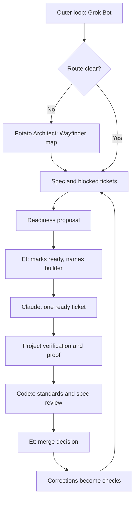

# Agent environment contract

This document defines the reusable workflow a project inherits from Sweet Potato. A project may add stricter rules. It may not silently remove these ones.

## Design target

An agent should be able to answer five questions without asking Et:

1. What outcome is wanted?
2. Which files and systems may it change?
3. Which states and operations are forbidden?
4. How does it prove the real behavior works?
5. Who reviews and who merges?

If the repository cannot answer those questions, the environment is not ready for autonomous implementation.

## Workflow



## Outer loop

Sweet Potato may read connected signals and create or update issues. Its token should not write repository contents, approve reviews or merge pull requests.

For each signal it chooses one route:

- discard with a recorded reason;
- add evidence to an existing issue;
- send an unclear or large request to Potato Architect;
- create one implementation ticket and propose it as ready after every readiness field is present;
- ask Et for one decision that cannot be derived safely.

Grouping precedes dispatch. Several symptoms with one likely cause become one investigation, not several builders changing the same area.

## Wayfinder planning

Use Wayfinder when any of these is true:

- the destination spans more than one agent run;
- the architecture has a material unknown;
- a language, framework, data model or authority decision is unresolved;
- two proposed tickets could change the same contract;
- production, security or money could be affected.

The map is a GitHub issue. Its child issues are decision tickets, not implementation work. Each decision records evidence, the choice, rejected alternatives and what it unblocks.

When the map resolves, Potato Architect writes the spec with `to-spec` and splits it into blocked implementation tickets with `to-tickets`.

## Who prepares what

| Step | Owner | Authority it grants |
| --- | --- | --- |
| Map and decision tickets | Potato Architect | None |
| Spec, tickets, acceptance criteria and dependencies for mapped work | Potato Architect | None |
| Tickets, acceptance criteria and dependencies for work whose route is clear | Sweet Potato | None |
| Readiness proposal | Sweet Potato or Potato Architect | None |
| Marking a ticket ready and naming its builder | Et | The named builder may start one attempt |
| Pull request with proof | The named builder | None |
| Standards and spec verdicts | The reviewer | None |
| Acceptance and merge | Et | The change lands |

Only Et grants authority. This is a soft rule: see [ADR 0006](adr/0006-et-authorizes-ready-work.md) for why GitHub cannot enforce it yet.

## Ready contract

A ticket is ready only when Et has added `ready-for-agent` and named the builder, and the ticket names:

- the user or operator outcome;
- the originating map or spec;
- exact scope and forbidden actions;
- acceptance criteria;
- required proof from the real artifact;
- required checks;
- blocking tickets;
- the builder Et named and the reviewer, from different model families;
- the project trust stage and merge authority.

## Inner loop

The builder owns one ticket, one branch and one active attempt. One builder session runs at a time across all tickets and sessions, matching `cap.buildersAtOnce`. Et launches builder sessions one after another and starts the next only after confirming the previous one stopped executing. Closing its branch or pull request is not that confirmation. A session whose status is unknown occupies the slot. This is a manual rule: nothing launches or stops builders automatically. The builder does not take adjacent work without a new ticket. It uses the project-local verification skill before it claims completion. See [the builder contract](../bots/claude-builder.md).

The reviewer pins the comparison point and performs two independent reviews:

1. Standards: language lane, repository rules, types, boundaries, tests, proof and blast radius.
2. Spec: every acceptance criterion, missing behavior and invented behavior.

Et receives a short outcome, the proof, both review verdicts and any unresolved risk. Et accepts or returns the work by hand and is the only one who merges. See [the reviewer contract](../bots/codex-reviewer.md).

## Verification contract

Every project-local verification skill must:

- start the real artifact or connect to an approved isolated environment;
- use a known fixture;
- exercise behavior through the real user or operator boundary;
- capture screenshots, logs, traces or terminal output as appropriate;
- report `PASS`, `FAIL` or `INCONCLUSIVE`;
- clean up its state;
- fail closed when required dependencies or credentials are unavailable;
- avoid production writes, migrations and paid model calls unless the project registry explicitly allows them.

Unit tests and mocks may support proof. They do not replace real-artifact proof for changed behavior.

The skill publishes its result as a proof bundle in `proof/`, which `scripts/check-proof.sh` checks. See [ADR 0005](adr/0005-commit-a-proof-bundle-with-every-pull-request.md).

`scripts/write-proof.sh` writes that bundle once the change is final. It stages everything outside `proof/`, replaces `proof/` with the real output of the commands you give it, and writes a manifest tied to the staged code:

```text
bash scripts/write-proof.sh --ticket Etdev2/sweet-potato#5 \
  --fixture "projects.json as committed" \
  --shows "All control-room suites exit 0 on this change." \
  -- "bash scripts/check-control-room.sh" "bash scripts/test-control-room.sh"
```

The result is `PASS` only when every command exits 0; otherwise the script writes a `FAIL` bundle and exits non-zero. If a command changes files outside `proof/`, the script stops instead of writing proof for code that moved. That includes changes hidden in a dirty submodule or behind `assume-unchanged` or `skip-worktree` flags. It also stops if a command replaces `proof/` with a symlink, and it writes nothing into `proof/` until the last command has finished. The command log stays outside the repository, so the script refuses a `TMPDIR` inside it. These checks catch verification that changes the code by accident. They are not a sandbox against a hostile command, and a reviewer still judges whether the evidence is honest. For a change with no user-visible behavior, add `--no-behavior-change "<reason>"`. Commit `proof/` with the change, and run the script again after any later edit.

## Trust progression

Projects climb one at a time:

| Stage | Builder authority | Et's role |
| --- | --- | --- |
| `stage-0-unverified` | No implementation runs | Establish the lane, checks and verification skill |
| `stage-1-supervised` | One ticket while Et watches each transition | Review proof and merge |
| `stage-2-proven` | One ready ticket asynchronously | Review the finished proof and merge |

A project advances only through a pull request that points to its evidence. Throughput does not advance trust by itself.

### What the registry requires before stage 1

`scripts/check-projects.sh` rejects a project in `projects.json` that is past `stage-0-unverified` unless:

- `verification.status` is `available`;
- `verification.command` is a non-blank string;
- `requiredChecks` lists at least one check name, each non-blank and unique.

It also rejects contradictions at any stage: a `missing` status with a command set, or an `available` status without one.

This validates configuration only. It does not run the command, confirm the named checks exist in the project repository, or stop a bot from starting work. Each project repository's CI runs the checks. Branch protection, which would make them a merge gate, is not available on the current GitHub plan.

## Environment improvement

Use the correction order from pstack:

1. redesign the architecture;
2. strengthen the types;
3. add a lint whose message names the repair;
4. add a behavior test;
5. add documentation only when code cannot enforce the rule.

Prove each new check against the real mistake class before counting it as a hard check.
